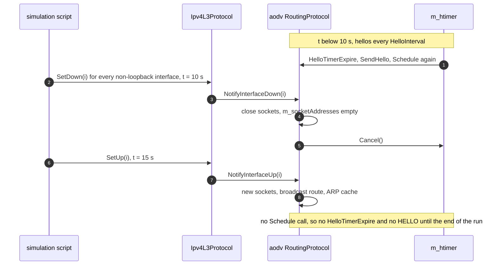
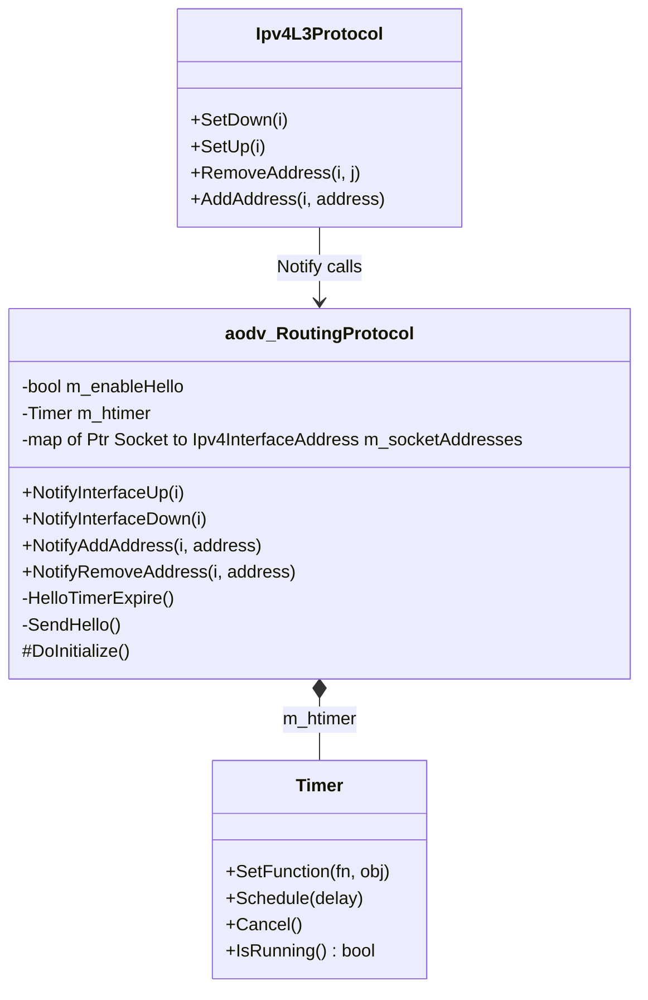

# NS3-004: AODV never restarts its hello timer when an interface comes back up

## Summary

| | |
|---|---|
| ID | NS3-004 |
| RCAPA ticket | [swarm-routing/sim-tools#362](https://github.com/swarm-routing/sim-tools/issues/362): `[rcapa] NS3-004 AODV never restarts its hello timer when an interface comes back up` |
| Status | open upstream; draft ready (not filed); no workaround (documented limit of the opt-in `--failures`) |
| Found | 2026-11-24, in [swarm-routing/sim-tools#361](https://github.com/swarm-routing/sim-tools/pull/361) (`routing-compare --failures`, [swarm-routing/sim-tools#128](https://github.com/swarm-routing/sim-tools/issues/128)) |
| Last checked | 2026-11-25: the standalone reproducer run on ns-3.49 (`ns3-dev:latest-debug`) and on ns-3-dev `master` `8a06b457`; the proposed fix run on both |
| ns-3 versions | run: 3.49, ns-3-dev `master` `8a06b457096e33ec072d13613001496de2569f0e` (2026-11-23); read: 3.49, the same `master` (the hello-timer code is identical, same line numbers) |
| Modules | `aodv` (`RoutingProtocol`: `NotifyInterfaceUp`, `NotifyInterfaceDown`, `NotifyAddAddress`, `NotifyRemoveAddress`, `HelloTimerExpire`, `DoInitialize`) |
| Impact on our repositories | only runs that take every AODV interface of a node down and up again: `routing-compare --failures` with a `shutdown` followed by a `start` ([swarm-routing/sim-tools#361](https://github.com/swarm-routing/sim-tools/pull/361)), opt-in. A restarted stock-`aodv` node routes through RREQ/RREP but sends no HELLO for the rest of the run, so neighbour-based link-break detection towards it is degraded and a restart comparison measures stock AODV in that state. Runs without `--failures` are unaffected. The other stock arms are not known to share it (OLSR's `NotifyInterfaceDown` is empty, a separate behaviour that the `--failures` README states). |
| Upstream | not yet reported; the draft is on [swarm-routing/sim-tools#362](https://github.com/swarm-routing/sim-tools/issues/362) |

When the last AODV interface of a node goes down, `NotifyInterfaceDown()`
cancels the hello timer. Nothing re-arms it: it is armed only once, in
`DoInitialize()`, and then only by its own expiry. So after an all-interfaces
down/up cycle the node never sends another HELLO, while it goes on answering
and forwarding route requests.

## Problem and detection

**Symptom.** A node whose IPv4 interfaces were all set down and then up again
sends zero HELLOs (RREP, hop count 0, TTL 1, dst = origin) for the rest of the
run; its neighbours keep sending theirs every `HelloInterval`.

**How it was detected.** While building scripted node failures for the harness
(`--failures`, [swarm-routing/sim-tools#128](https://github.com/swarm-routing/sim-tools/issues/128),
[swarm-routing/sim-tools#361](https://github.com/swarm-routing/sim-tools/pull/361)), the chain
test of the `shutdown`/`start` events on ns-3.49 (`ns3-dev:latest-debug`)
showed a restarted stock-AODV node that routed but sent no hellos. The source
read recorded on [swarm-routing/sim-tools#362](https://github.com/swarm-routing/sim-tools/issues/362)
(2026-11-25) found the cause; the standalone reproducer below confirms it on
stock ns-3 with no harness code.

## Reproduction

The minimal program uses stock ns-3 models only:
[`aodv-hello-restart.cc`](aodv-hello-restart.cc), next to this page. Three
static nodes in a line 50 m apart, 802.11 ad hoc with ns-3's defaults
(`YansWifiChannelHelper::Default()`), stock AODV with `EnableHello=true`
(`HelloInterval` 1 s). At 10 s every non-loopback IPv4 interface of node 1 is
set down (`Ipv4::SetDown`, so AODV gets `NotifyInterfaceDown`), at 15 s up
again (`NotifyInterfaceUp`); the run ends at 30 s. A HELLO is counted on each
node's `Ipv4L3Protocol` `Tx` trace: TTL 1, UDP port 654, an RREP with hop
count 0 and dst = origin (what `RoutingProtocol::SendHello` builds). No
randomness beyond AODV's hello jitter; the default seed.

```bash
# in an ns-3 tree (3.49 at /opt/ns-3 in the image)
cp aodv-hello-restart.cc scratch/
./ns3 build scratch/aodv-hello-restart
./ns3 run --no-build scratch/aodv-hello-restart

# the same in the image, with this repository checked out at $PWD
docker run --rm --cpus 2 -v "$PWD/docs/ns3-rcapa:/repro:ro" ghcr.io/swarm-routing/ns3-dev:latest-debug bash -c \
    'cd /opt/ns-3 && cp /repro/aodv-hello-restart.cc scratch/ && ./ns3 build -j2 scratch/aodv-hello-restart && ./ns3 run --no-build scratch/aodv-hello-restart'
```

HELLOs sent per node in each window (before: 0–10 s; down: 10–15 s; after: 15–30 s):

| Build | node 0 | node 1 (restarted) | node 2 | Verdict |
|---|---|---|---|---|
| ns-3.49, stock | 10 / 5 / 15 | 10 / 0 / **0** | 10 / 5 / 15 | reproduced |
| ns-3-dev `master` `8a06b457`, stock | 10 / 5 / 15 | 10 / 0 / **0** | 10 / 5 / 15 | reproduced |
| ns-3.49 with the proposed fix | 10 / 5 / 15 | 10 / 0 / **15** | 10 / 5 / 15 | not reproduced |
| ns-3-dev `master` `8a06b457` with the proposed fix | 10 / 5 / 15 | 10 / 0 / **15** | 10 / 5 / 15 | not reproduced |

Control, no restart (`--downAt=100 --upAt=100`): every node sends 30 HELLOs
in 30 s, stock and fixed, on both trees. `src/aodv/model/aodv-routing-protocol.cc`
is byte-identical in ns-3.49 and this `master` (`diff`, 2026-11-25), so the
patch and every line number on this page hold for both.
- Image: `ghcr.io/swarm-routing/ns3-dev:latest-debug@sha256:25b7b1332197252a54c72e72a8a26b00b0bc1012306d831c5faa01df730972bc`
  (ns-3.49, `VERSION` read in the image on 2026-11-25).
- ns-3-dev `master`: no `ns3-dev` image tracks it (the registry's tags are
  releases and `latest-*`), so a shallow clone of
  `https://gitlab.com/nsnam/ns-3-dev.git` at `8a06b457096e33ec072d13613001496de2569f0e` (2026-11-23,
  read with `git rev-parse HEAD` in the clone) was built inside
  `ns3-dev:latest-debug` with its toolchain:
  `./ns3 configure -d debug --disable-werror --enable-modules="aodv;wifi;internet;mobility;applications"`.
- Expected: node 1 sends about 15 HELLOs after 15 s, like its neighbours.
- Actual: node 1 sends none after 15 s; it sent 10 before going down, so the
  timer worked until `NotifyInterfaceDown` cancelled it.

## Root cause: five whys

1. **Why does node 1 send no HELLO after it comes back up?** HELLOs are sent
   only by `HelloTimerExpire()` → `SendHello()`
   (`src/aodv/model/aodv-routing-protocol.cc:1932–1949`, `:1975`, ns-3.49 and
   `master`), and `m_htimer` is not running after the restart: 0 HELLOs from
   node 1 between 15 and 30 s in the reproducer, against 15 from each
   neighbour.
2. **Why is the timer not running?** `NotifyInterfaceDown()` cancels it when
   the last AODV interface goes: `if (m_socketAddresses.empty())` →
   `m_htimer.Cancel()` (`aodv-routing-protocol.cc:826–833`, ns-3.49 and
   `master`). `NotifyRemoveAddress()` does the same when the last AODV
   address goes (`:954–961`).
3. **Why does coming back up not restart it?** `NotifyInterfaceUp()`
   (`aodv-routing-protocol.cc:721–786`) recreates the two sockets, the
   broadcast route, the ARP cache and the wifi `DroppedMpdu` hook, the exact
   inverse of `NotifyInterfaceDown()`, but has no `m_htimer` call;
   `NotifyAddAddress()` (`:838–895`) likewise.
4. **Why does nothing else re-arm it?** The timer is armed once, in
   `DoInitialize()` (`m_htimer.SetFunction(...)`, `m_htimer.Schedule(MilliSeconds(startTime))`,
   `aodv-routing-protocol.cc:2325–2331`), and re-armed only from its own
   expiry (`HelloTimerExpire()`, `:1945–1947`). Once cancelled, no path
   schedules it again for the node's lifetime.
5. **Why did no test catch it?** The `aodv` module's tests
   (`src/aodv/test/`: `aodv-test-suite.cc`, `aodv-regression.cc`,
   `bug-772.cc`, `loopback.cc`, `aodv-id-cache-test-suite.cc`, ns-3.49) never
   take an interface down on a running node: none calls `SetDown` or `SetUp`
   (read for this page). At start-up the asymmetry is invisible, since the
   interfaces come up before `DoInitialize()` arms the timer, so only a
   down/up cycle after start shows it. (Why the down path got a cancel and the
   up path no restart is not recorded in the source; a hypothesis is that the
   up path was written for start-up only.)

**Root cause.** `aodv::RoutingProtocol` cancels `m_htimer` when it loses its
last interface or address but has no matching restart when one returns; the
only places that schedule the timer are `DoInitialize()` and the timer's own
expiry.

## Diagrams

### Failing call chain



### ns-3 types involved



## Source excerpts

`src/aodv/model/aodv-routing-protocol.cc:826–833`, ns-3.49 (identical on
`master` `8a06b457`), the end of `NotifyInterfaceDown()`:

```cpp
    if (m_socketAddresses.empty())
    {
        NS_LOG_LOGIC("No aodv interfaces");
        m_htimer.Cancel();
        m_nb.Clear();
        m_routingTable.Clear();
        return;
    }
```

`src/aodv/model/aodv-routing-protocol.cc:2325–2331`, ns-3.49 (identical on
`master`), the only place outside the timer's own expiry that schedules it:

```cpp
    if (m_enableHello)
    {
        m_htimer.SetFunction(&RoutingProtocol::HelloTimerExpire, this);
        uint32_t startTime = m_uniformRandomVariable->GetInteger(0, 100);
        NS_LOG_DEBUG("Starting at time " << startTime << "ms");
        m_htimer.Schedule(MilliSeconds(startTime));
    }
```

`src/aodv/model/aodv-routing-protocol.cc:1945–1947`, ns-3.49 (identical on
`master`), the re-arm in `HelloTimerExpire()`:

```cpp
    m_htimer.Cancel();
    Time diff = m_helloInterval - offset;
    m_htimer.Schedule(std::max(Seconds(0), diff));
```

`NotifyInterfaceUp()` (`:721–786`) contains no `m_htimer` call.

## Corrective actions

The fix belongs upstream: re-arm `m_htimer` where AODV regains an interface
or an address, when hellos are on and the timer is not running. The
`IsInitialized()` guard keeps the start-up path as it is: interfaces come up
before `DoInitialize()`, which has not yet set the timer's function and arms
the timer itself, so a run without a restart takes the same path as before.
Against ns-3-dev `master` `8a06b457`
(applies unchanged to ns-3.49):

```diff
--- a/src/aodv/model/aodv-routing-protocol.cc
+++ b/src/aodv/model/aodv-routing-protocol.cc
@@ -752,6 +752,13 @@
     socket->SetIpRecvTtl(true);
     m_socketSubnetBroadcastAddresses.insert(std::make_pair(socket, iface));
 
+    // NotifyInterfaceDown() cancels the hello timer when the last AODV interface
+    // goes down; restart it when one comes back (DoInitialize() arms it at start).
+    if (m_enableHello && IsInitialized() && !m_htimer.IsRunning())
+    {
+        m_htimer.Schedule(MilliSeconds(m_uniformRandomVariable->GetInteger(0, 100)));
+    }
+
     // Add local broadcast record to the routing table
     Ptr<NetDevice> dev = m_ipv4->GetNetDevice(m_ipv4->GetInterfaceForAddress(iface.GetLocal()));
     RoutingTableEntry rt(/*dev=*/dev,
@@ -873,6 +880,12 @@
             socket->SetIpRecvTtl(true);
             m_socketSubnetBroadcastAddresses.insert(std::make_pair(socket, iface));
 
+            // NotifyRemoveAddress() cancels the hello timer with the last AODV address.
+            if (m_enableHello && IsInitialized() && !m_htimer.IsRunning())
+            {
+                m_htimer.Schedule(MilliSeconds(m_uniformRandomVariable->GetInteger(0, 100)));
+            }
+
             // Add local broadcast record to the routing table
             Ptr<NetDevice> dev =
                 m_ipv4->GetNetDevice(m_ipv4->GetInterfaceForAddress(iface.GetLocal()));
```

With it, the reproducer's node 1 sends HELLOs again after 15 s (table above),
and nodes 0 and 2 are unchanged.

| Action | Where | Status |
|--------|-------|--------|
| Harness workaround: none. `--failures` is opt-in, and patching stock AODV in the harness would make the `aodv` arm stop being stock AODV; the limit is documented instead | [swarm-routing/sim-tools#362](https://github.com/swarm-routing/sim-tools/issues/362) | decided (none) |
| `ns3/routing-bench/README.md` "Scripted failures" names NS3-004 next to the `shutdown`/`start` events: a restarted AODV node finds routes by RREQ but sends no hellos | [swarm-routing/sim-tools#361](https://github.com/swarm-routing/sim-tools/pull/361) | open (in that PR, not merged yet) |
| Upstream fix: the patch above, through the upstream report | [swarm-routing/sim-tools#362](https://github.com/swarm-routing/sim-tools/issues/362) | draft ready |

## Preventive actions

| Action | Where | Status |
|--------|-------|--------|
| The standalone reproducer, which prints a `VERDICT` line: re-run it on every new `latest` and on ns-3-dev `master` until a release carries the fix | [`aodv-hello-restart.cc`](aodv-hello-restart.cc), [swarm-routing/sim-tools#362](https://github.com/swarm-routing/sim-tools/issues/362) | done (the program); re-runs open with the ticket |
| Propose the reproducer upstream as an `aodv` test case (a down/up cycle counts HELLOs after the restart), with the fix | upstream report on [swarm-routing/sim-tools#362](https://github.com/swarm-routing/sim-tools/issues/362) | draft ready |
| The harness's `--failures` tests ([swarm-routing/sim-tools#361](https://github.com/swarm-routing/sim-tools/pull/361)) check a restarted node's behaviour per arm, so a lifecycle defect in any stock arm shows there before a campaign uses restarts; a protocol's own lifecycle hooks are [swarm-routing/sim-tools#150](https://github.com/swarm-routing/sim-tools/issues/150) | [swarm-routing/sim-tools#361](https://github.com/swarm-routing/sim-tools/pull/361) | open |
| On the first ns-3 release with the fix: re-run the reproducer on it, drop the README sentence's limit, set the register row to **fixed in ns-3.X** | [swarm-routing/sim-tools#362](https://github.com/swarm-routing/sim-tools/issues/362) | open |

## Upstream report

**Status: draft ready, not yet reported.** The text is a comment on
[swarm-routing/sim-tools#362](https://github.com/swarm-routing/sim-tools/issues/362)
(edits are made there): title, description with the source lines, this
reproducer and its table, and the patch above. The maintainer files it under
their own account, through
[swarm-routing/ns3-upstream-report](https://github.com/swarm-routing/ns3-upstream-report);
the link then goes into the ticket, this page and the register.

Before filing: the nsnam GitLab issues were not searched for an existing
report in this session; the bridge's pre-filing step should.

## Timeline

| Date | Event |
|------|-------|
| 2026-11-24 | seen in the `--failures` chain test of [swarm-routing/sim-tools#361](https://github.com/swarm-routing/sim-tools/pull/361) on ns-3.49 |
| 2026-11-25 | RCAPA ticket [swarm-routing/sim-tools#362](https://github.com/swarm-routing/sim-tools/issues/362) opened with the source read; standalone reproducer run on ns-3.49 and ns-3-dev `master` `8a06b457` (reproduced on both); fix run on both; upstream draft on the ticket |

## Links

- RCAPA ticket: [swarm-routing/sim-tools#362](https://github.com/swarm-routing/sim-tools/issues/362)
- Where it was found: [swarm-routing/sim-tools#361](https://github.com/swarm-routing/sim-tools/pull/361), [swarm-routing/sim-tools#128](https://github.com/swarm-routing/sim-tools/issues/128); a protocol's own lifecycle: [swarm-routing/sim-tools#150](https://github.com/swarm-routing/sim-tools/issues/150)
- Another AODV defect: NS3-001, [swarm-routing/sim-tools#238](https://github.com/swarm-routing/sim-tools/issues/238), [`ns3-rcapa-aodv-icmp-livelock.md`](ns3-rcapa-aodv-icmp-livelock.md)
- ns-3 sources: [`aodv-routing-protocol.cc` at ns-3.49](https://gitlab.com/nsnam/ns-3-dev/-/blob/ns-3.49/src/aodv/model/aodv-routing-protocol.cc), [at `master` `8a06b457`](https://gitlab.com/nsnam/ns-3-dev/-/blob/8a06b457096e33ec072d13613001496de2569f0e/src/aodv/model/aodv-routing-protocol.cc)
- RFC 3561 §6.9, Hello messages (https://www.rfc-editor.org/rfc/rfc3561#section-6.9)
