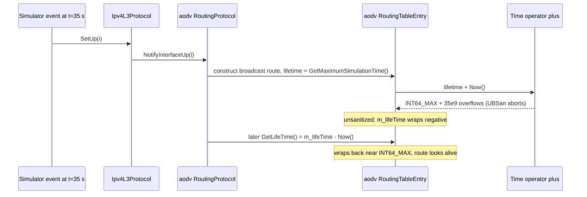
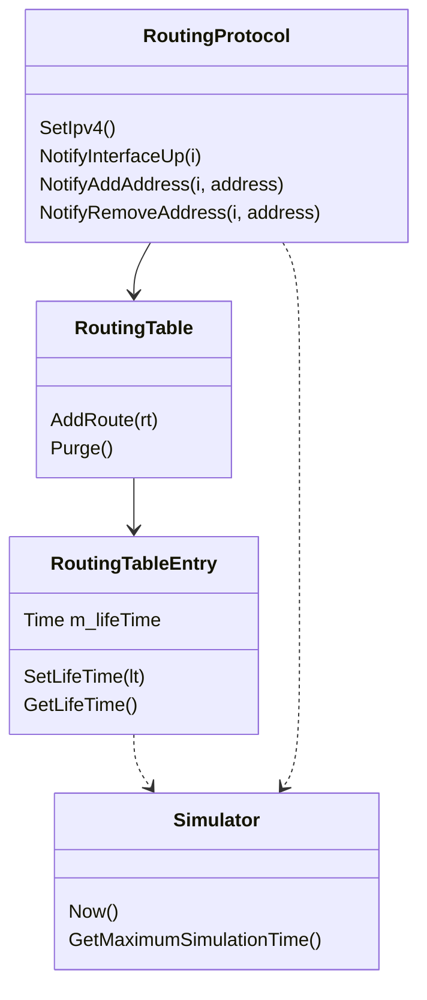

# NS3-005: AODV route lifetime overflows int64 when an interface comes up after t=0

## Summary

| | |
|---|---|
| ID | NS3-005 |
| RCAPA ticket | [swarm-routing/sim-tools#374](https://github.com/swarm-routing/sim-tools/issues/374): `[rcapa] NS3-005 AODV broadcast route lifetime overflows int64 when an interface comes up after t=0` |
| Status | open upstream; not yet reported; patch kept here (`ns3/patches/NS3-005/`), not yet applied to the images |
| Found | 2026-11-25, by the [swarm-routing/sim-tools#361](https://github.com/swarm-routing/sim-tools/pull/361) shepherd (`routing-compare --failures`, a node `start`), in `ns3-dev:latest-sanitized` |
| Last checked | 2026-11-25: the standalone reproducer run on ns-3.49 (`ns3-dev:latest-sanitized` and `latest-debug`) and on ns-3-dev `master` `d07400ba`; the patch run on both; the source read back to ns-3.7 |
| ns-3 versions | run: 3.49, ns-3-dev `master` `d07400baf45375afe6311d996ddc498722114f6d` (2026-11-25); read: 3.7 to 3.49 and that `master` (the unchecked add and the maximum-time lifetime are in every one; `aodv-rtable.{cc,h}` are byte-identical from 3.44 to `master`); not affected: 3.6 and older (no AODV module; read) |
| Modules | `aodv` (`RoutingTableEntry`'s constructor and `SetLifeTime`; the callers in `RoutingProtocol`: `SetIpv4`, `NotifyInterfaceUp`, `NotifyAddAddress`, `NotifyRemoveAddress`); seen through `core` (`Time::operator+`) |
| Impact on our repositories | any run that brings an AODV interface up after t=0: today only `routing-compare --failures` with a `start` ([swarm-routing/sim-tools#361](https://github.com/swarm-routing/sim-tools/pull/361), opt-in, not merged). On a sanitized build (`ns3-dev:*-sanitized`, CI's sanitized leg) the run aborts; on any other build it runs on undefined behaviour. Runs without interface changes after t=0 are unaffected. DSDV, OLSR and HWMP do not share it (read, below). |
| Upstream | not yet reported |

AODV gives the routes that must never expire (the loopback route and each
interface's local broadcast route) the lifetime
`Simulator::GetMaximumSimulationTime()`, the largest `Time` (`INT64_MAX`
ticks). `aodv::RoutingTableEntry` stores an absolute expiry, `lifetime +
Simulator::Now()`, with no check, so creating such a route at any time after
t=0 overflows a signed 64-bit integer: undefined behaviour, which UBSan turns
into an abort.

## Problem and detection

**Symptom.** In `ns3-dev:latest-sanitized` (ns-3.49), a `routing-compare
--failures` run aborted at the scripted `start` of a node, the first time
the node's interfaces came up after t=0:

```
nstime.h:942: runtime error: signed integer overflow: 9223372036854775807 + 35000000000 cannot be represented in type 'long int'
```

with the stack `ApplyFailure` (`failure-schedule.cc:94`, the harness's
failure schedule in [swarm-routing/sim-tools#361](https://github.com/swarm-routing/sim-tools/pull/361))
→ `IcmpErrorGuardRouting::NotifyInterfaceUp` (the NS3-001 guard, which
forwards it) → `aodv::RoutingProtocol::NotifyInterfaceUp` →
`aodv::RoutingTableEntry::RoutingTableEntry` → `ns3::operator+(Time, Time)`.

**How it was detected.** The
[swarm-routing/sim-tools#361](https://github.com/swarm-routing/sim-tools/pull/361)
shepherd ran the failure scripts on the sanitized image. The standalone
reproducer below shows the same abort with stock ns-3 only, so the harness and
its guard only pass the call on.

## Reproduction

The minimal program uses stock ns-3 models only:
[`aodv-lifetime-overflow.cc`](../../ns3/patches/NS3-005/aodv-lifetime-overflow.cc).
Two nodes on a CSMA link, stock AODV (`AodvHelper` defaults). At 1 s node 1's
CSMA interface is set down (`Ipv4::SetDown`), at 35 s up again
(`Ipv4::SetUp`, so AODV gets `NotifyInterfaceUp`); at 36 s node 1's AODV
routing table is printed and the run ends at 37 s. No randomness matters (the
default seed).

```bash
# in an ns-3 tree built with --enable-sanitizers (3.49 at /opt/ns-3 in the image)
cp aodv-lifetime-overflow.cc scratch/
./ns3 build scratch/aodv-lifetime-overflow
./ns3 run --no-build scratch/aodv-lifetime-overflow

# the same in the image, with this repository checked out at $PWD
docker run --rm -v "$PWD/ns3/patches/NS3-005:/repro:ro" ghcr.io/swarm-routing/ns3-dev:latest-sanitized bash -c \
    'cd /opt/ns-3 && cp /repro/aodv-lifetime-overflow.cc scratch/ && ./ns3 build scratch/aodv-lifetime-overflow &&
     UBSAN_OPTIONS=print_stacktrace=1 ./ns3 run --no-build scratch/aodv-lifetime-overflow'

# the whole proof (reproducer stock and patched, the apply script, the AODV suites)
docker run --rm -v "$PWD:/src:ro" ghcr.io/swarm-routing/ns3-dev:latest-sanitized \
    bash /src/ns3/patches/NS3-005/test.sh /opt/ns-3
```

| Build | Result | Verdict |
|---|---|---|
| ns-3.49 sanitized (`latest-sanitized`), stock | `runtime error: signed integer overflow: 9223372036854775807 + 35000000000`, exit 1 | reproduced |
| ns-3-dev `master` `d07400ba` sanitized, stock | `runtime error: signed integer overflow: 9223372036854775807 + 35000000000`, exit 1 | reproduced |
| ns-3.49 debug, no sanitizers (`latest-debug`), stock | runs to the end; the broadcast route reads `10.0.0.255 … UP +9.2e+09s` | undefined behaviour, not visible |
| ns-3.49 sanitized with the patch | runs to the end, `NS3-005 not-reproduced`, broadcast route `UP +9.2e+09s`; `routing-aodv`, `aodv-routing-id-cache`, `routing-aodv-loopback`, `routing-aodv-regression` pass | not reproduced |
| ns-3-dev `master` `d07400ba` sanitized with the patch | `apply.sh`: applied; runs to the end, `NS3-005 not-reproduced`, broadcast route `UP +9.2e+09s`; the four AODV suites pass | not reproduced |

The stack on ns-3.49 (`UBSAN_OPTIONS=print_stacktrace=1`, frames in ns-3):

```
#0 ns3::operator+(ns3::Time const&, ns3::Time const&) src/core/model/nstime.h:942
#1 ns3::aodv::RoutingTableEntry::RoutingTableEntry(...) src/aodv/model/aodv-rtable.cc:49
#2 ns3::aodv::RoutingProtocol::NotifyInterfaceUp(unsigned int) src/aodv/model/aodv-routing-protocol.cc:764
#3 ns3::Ipv4L3Protocol::SetUp(unsigned int) src/internet/model/ipv4-l3-protocol.cc:1336
```

- Image: `ghcr.io/swarm-routing/ns3-dev:latest-sanitized@sha256:b8899b2480b186b18ad4e2020d9da05210a623cedfa598b7c2e3742fad716c43`
  (ns-3.49, `VERSION` read in the image on 2026-11-25; profile `-d debug
  --enable-sanitizers`, which compiles with `-fno-sanitize-recover=all`), and
  `ghcr.io/swarm-routing/ns3-dev:latest-debug@sha256:b6149c3dc2000062327963c24bbd5a373de66f76cacb9f5479510966c135d813`.
- ns-3-dev `master`: `git archive` of `d07400baf45375afe6311d996ddc498722114f6d`
  (2026-11-25) from `https://gitlab.com/nsnam/ns-3-dev.git`, configured inside
  `latest-debug` with `-d debug --enable-sanitizers --enable-tests
  --enable-modules='core;network;internet;csma;aodv'`.
- Seed / RngRun: the defaults; the overflow does not depend on them.
- Expected: the broadcast route is added with a lifetime that never expires.
- Actual: `lifetime + Now()` overflows `int64`.
- Minimal program: [`ns3/patches/NS3-005/aodv-lifetime-overflow.cc`](../../ns3/patches/NS3-005/aodv-lifetime-overflow.cc)
  (the commit is in the ticket, swarm-routing/sim-tools#374, once merged).

## Root cause: five whys

1. **Why does the sanitized run abort when the interface comes up?**
   `Time operator+` adds the two `int64` tick counts with no check
   (`src/core/model/nstime.h:942`, ns-3.49: `return Time(lhs.m_data +
   rhs.m_data);`), and here they are `INT64_MAX` and 35·10⁹ ns: a signed
   overflow, which `-fsanitize=undefined -fno-sanitize-recover=all` reports and
   aborts on (run, above).
2. **Why is `INT64_MAX` added to the current time?** `RoutingTableEntry`
   stores the absolute expiry time, `m_lifeTime(lifetime + Simulator::Now())`
   (`src/aodv/model/aodv-rtable.cc:49`, ns-3.49; `SetLifeTime` does the same,
   `aodv-rtable.h:258`), and `NotifyInterfaceUp` passes
   `/*lifetime=*/Simulator::GetMaximumSimulationTime()` for the interface's
   local broadcast route (`src/aodv/model/aodv-routing-protocol.cc:764`), the
   largest `Time` (`DefaultSimulatorImpl::GetMaximumSimulationTime`, the
   `9223372036854775807` in the report). The same lifetime is passed for the
   loopback route in `SetIpv4` (line 714) and for the broadcast route in
   `NotifyAddAddress` (line 886) and `NotifyRemoveAddress` (line 951).
3. **Why does it not overflow in an ordinary run?** All four calls run at
   t=0 there: `SetIpv4` when the stack is installed and `NotifyInterfaceUp`
   when addresses are assigned, both before `Simulator::Run()`, so `Now()` is
   0 and `INT64_MAX + 0` fits. Only an interface that comes up, or an address
   that changes, after t=0 reaches it (a restart, a late `Ipv4::SetUp`, an
   address added later, a stack installed during the run). No AODV test or
   example calls `SetUp`, `SetDown` or `AddAddress` (read: `src/aodv/test/`,
   `src/aodv/examples/`, ns-3.49), so ns-3's own suites never take that path.
4. **Why did no unsanitized run notice?** On a two's-complement machine the
   wrap is undone by the next subtraction: `GetLifeTime()` and `Print()` return
   `m_lifeTime - Simulator::Now()` (`aodv-rtable.h:267`, `aodv-rtable.cc:185`),
   which overflows back to `INT64_MAX - (elapsed)`. So the route looks alive
   and `RoutingTable::Purge` (which tests `GetLifeTime().IsStrictlyNegative()`)
   keeps it: the debug build prints `UP +9.2e+09s` (run, above). Two
   undefined operations that cancel on today's compiler at `-O0`; an optimizer
   may assume neither overflows. Optimized builds were not run.
5. **Why is "never expires" a value that overflows?** `RoutingTableEntry` has
   no notion of an infinite lifetime: it keeps one signed absolute time and
   every setter adds `Now()` unchecked, while its callers spell "never" as the
   largest representable time. Both have been so since AODV entered ns-3, in
   ns-3.7 (2010; read: `ns-3.7` `src/routing/aodv/aodv-rtable.cc:48` holds the
   constructor's `lifetime + Simulator::Now ()`, and
   `src/routing/aodv/aodv-routing-protocol.cc` three calls with the maximum
   lifetime; ns-3.8 and later, four), when AODV routes were only created at
   t=0 in practice.

Other places, read on ns-3.49: DSDV passes the same maximum lifetime
(`src/dsdv/model/dsdv-routing-protocol.cc:982`, `1016`, `1076`) but its
`RoutingTableEntry` stores it as given (`m_lifeTime(lifetime)`,
`src/dsdv/model/dsdv-rtable.cc:44`), so nothing overflows. No other
`Simulator::GetMaximumSimulationTime()` or `Time::Max()` in `src/` is added to
`Now()` (the one line holding both, `src/wifi/model/wifi-mac-queue.cc:521`,
chooses between them). AODV's `RoutingTableEntry::Invalidate` adds the
`DeletePeriod`-derived `badLinkLifetime` to `Now()` unchecked
(`aodv-rtable.cc:165`); it overflows only for an attribute value near
`INT64_MAX`, so the patch leaves it.

## Diagrams

### Failing call chain



### ns-3 types involved



## Source excerpts

`src/aodv/model/aodv-routing-protocol.cc:757–765`, ns-3.49 (`NotifyInterfaceUp`):

```cpp
    RoutingTableEntry rt(/*dev=*/dev,
                         /*dst=*/iface.GetBroadcast(),
                         /*vSeqNo=*/true,
                         /*seqNo=*/0,
                         /*iface=*/iface,
                         /*hops=*/1,
                         /*nextHop=*/iface.GetBroadcast(),
                         /*lifetime=*/Simulator::GetMaximumSimulationTime());
    m_routingTable.AddRoute(rt);
```

`src/aodv/model/aodv-rtable.cc:45–49`, ns-3.49:

```cpp
    : m_ackTimer(Timer::CANCEL_ON_DESTROY),
      m_validSeqNo(vSeqNo),
      m_seqNo(seqNo),
      m_hops(hops),
      m_lifeTime(lifetime + Simulator::Now()),
```

`src/aodv/model/aodv-rtable.h:256–268`, ns-3.49:

```cpp
    void SetLifeTime(Time lt)
    {
        m_lifeTime = lt + Simulator::Now();
    }
    ...
    Time GetLifeTime() const
    {
        return m_lifeTime - Simulator::Now();
    }
```

## The fix

[`ns3/patches/NS3-005/ns3-005-aodv-lifetime-saturate.patch`](../../ns3/patches/NS3-005/ns3-005-aodv-lifetime-saturate.patch):
`SetLifeTime` saturates at `Simulator::GetMaximumSimulationTime()`, and the
constructor sets its lifetime through `SetLifeTime` instead of its own add.

```cpp
    void SetLifeTime(Time lt)
    {
        const Time maxTime = Simulator::GetMaximumSimulationTime();
        m_lifeTime = lt < maxTime - Simulator::Now() ? lt + Simulator::Now() : maxTime;
    }
```

`maxTime - Now()` cannot overflow (`Now()` is never negative), and an expiry of
`GetMaximumSimulationTime()` is the "never" its callers mean; every lifetime
below the saturation point is unchanged, so no run without the bug moves.
Fixing it in the entry, not at the four call sites, also covers any caller
that passes a lifetime that large. Alternatives weighed: callers passing
`GetMaximumSimulationTime() - Now()` (four edits, and the next caller repeats
the bug); a separate "infinite" flag (more change than the defect needs).

**Applying it only where the bug is.**
[`ns3/patches/NS3-005/apply.sh`](../../ns3/patches/NS3-005/apply.sh) decides
from the source, not from the version (no ns-3 release has a fix yet, so no
version list can say where one starts, and a `master` or already-patched tree
carries the same version as a stock one): `not-affected` for a tree with no
AODV, `already-fixed` for a tree the patch applies to in reverse (already
patched) and for one without the bug's signature (an unchecked
`lifetime + Simulator::Now()` in the constructor or `SetLifeTime`: fixed or
rewritten upstream); `applied` where the signature is and the patch fits
(`git apply --check`: ns-3.44 to 3.49 and `master` `d07400ba`, read), and
`refused` (exit 1), asking for a refreshed patch, where the signature is but
the patch does not fit (ns-3.7 to 3.43). Each case prints one
`NS3-005: <outcome>: …` line, the four outcomes of every patch in
`ns3/patches/` (its README, [swarm-routing/sim-tools#378](https://github.com/swarm-routing/sim-tools/issues/378)). It is the vcpkg `ns3` port's NS3-001 mechanism
(swarm-routing/vcpkg-registry `ports/ns3/portfile.cmake`, forward and reverse
`git apply --check`) with the signature check added, because a patch that
does not fit is not proof that the bug is gone.

## Corrective actions (ours)

| Action | Where | Status |
|--------|-------|--------|
| The fix as a patch to ns-3, applied only to a source with the bug, with its reproducer and test | `ns3/patches/NS3-005/` (this RCAPA's pull request, part of swarm-routing/sim-tools#374) | done (in review) |
| Apply the patch in the `ns3-dev` images' ns-3 build, so sanitized runs with interface restarts no longer abort | swarm-routing/sim-containers (`docker/`), a later step of swarm-routing/sim-tools#374 | open |
| `routing-compare --failures` restarts run on sanitized builds only with a patched ns-3; its README names NS3-005 | [swarm-routing/sim-tools#361](https://github.com/swarm-routing/sim-tools/pull/361) (open; not changed here) | open |

## Preventive actions

| Action | Where | Status |
|--------|-------|--------|
| CI proves the patch on every pull request: `apply.sh`'s five decisions, the reproducer failing on the stock sanitized tree and passing patched, the four AODV suites, and `already-fixed` on a patched tree | `.github/workflows/ns3.yml` job `ns3-patches`, `ns3/patches/NS3-005/test.sh` | done (in review) |
| When ns-3 ships a fix, `apply.sh` prints `already-fixed` by itself; the reproducer then confirms the release | `ns3/patches/NS3-005/apply.sh` | done (in review) |
| The upstream report asks for an AODV test that brings an interface up after t=0 under the sanitizers, the path ns-3's suites never take | swarm-routing/ns3-upstream-report | open (a later step of swarm-routing/sim-tools#374) |

## Upstream report

Status: not yet reported. It goes out only through
[swarm-routing/ns3-upstream-report](https://github.com/swarm-routing/ns3-upstream-report)
(`reports/NS3-005.md`), a later step of
[swarm-routing/sim-tools#374](https://github.com/swarm-routing/sim-tools/issues/374).
Draft:

> **Title:** aodv: route lifetime overflows int64 when an interface comes up after t=0
>
> `aodv::RoutingTableEntry` stores `lifetime + Simulator::Now()`
> (`aodv-rtable.cc:49`; `SetLifeTime` in `aodv-rtable.h` likewise), and
> `RoutingProtocol` passes `Simulator::GetMaximumSimulationTime()` as the
> lifetime of the loopback and local broadcast routes (`SetIpv4`,
> `NotifyInterfaceUp`, `NotifyAddAddress`, `NotifyRemoveAddress`). When an
> interface comes up after t=0 (`Ipv4::SetUp` at 35 s), the add overflows
> `int64_t`; a build with `--enable-sanitizers` aborts with
> `nstime.h:942: runtime error: signed integer overflow: 9223372036854775807 + 35000000000`.
> Without sanitizers it is undefined behaviour that `GetLifeTime()`'s own
> subtraction happens to undo. Seen on ns-3.49 and `master`; the code dates
> from ns-3.7. A two-node CSMA reproducer and a proposed fix (saturate
> `SetLifeTime` at `GetMaximumSimulationTime()` and use it in the
> constructor) are attached; AODV's four test suites pass with it. A test
> that sets an AODV interface down and up after t=0 under the sanitizers
> would keep it fixed.

## Timeline

| Date | Event |
|------|-------|
| 2026-11-25 | The [swarm-routing/sim-tools#361](https://github.com/swarm-routing/sim-tools/pull/361) shepherd sees UBSan abort a `--failures` restart in `ns3-dev:latest-sanitized`. |
| 2026-11-25 | RCAPA ticket [swarm-routing/sim-tools#374](https://github.com/swarm-routing/sim-tools/issues/374) opened; standalone reproducer run on ns-3.49 and ns-3-dev `master` `d07400ba`; source read back to ns-3.7; patch, apply script and test written and run. |

## Links

- [swarm-routing/sim-tools#374](https://github.com/swarm-routing/sim-tools/issues/374) (RCAPA ticket)
- [swarm-routing/sim-tools#361](https://github.com/swarm-routing/sim-tools/pull/361) (`--failures`, where it was found), [swarm-routing/sim-tools#128](https://github.com/swarm-routing/sim-tools/issues/128)
- NS3-004 ([swarm-routing/sim-tools#362](https://github.com/swarm-routing/sim-tools/issues/362)): another AODV defect on the same restart path
- NS3-001 ([swarm-routing/sim-tools#238](https://github.com/swarm-routing/sim-tools/issues/238)): its guard forwards `NotifyInterfaceUp` here; swarm-routing/vcpkg-registry `ports/ns3/portfile.cmake` applies its upstream fix by the same source-decided method
- `ns3/patches/NS3-005/` (the patch, `apply.sh`, the reproducer, `test.sh`)
