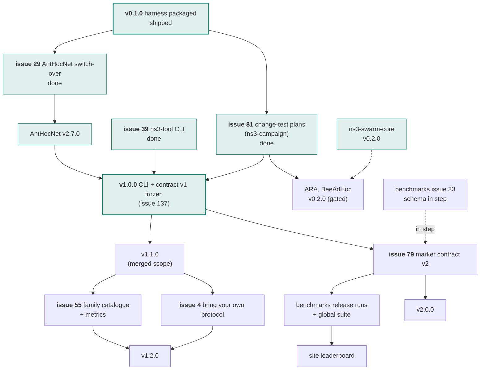

# Roadmap

The plan in one page. The live plan is this page plus the `release:` labels
below; issue state is always truer than a checked-in diagram. The ladder was
adopted by the maintainer on 2026-11-11 ("adopt the release ladder and replace
the phase-targets rule") and follows
[AntHocNet's roadmap](https://github.com/swarm-routing/AntHocNet/blob/main/docs/roadmap.md).
It was re-scoped by the maintainer on **2026-11-13** ("ns3-tools now, core
later"): *"ns3-tools v1.0.0 now: freeze today's CLI and marker contract v1,
the one AntHocNet and benchmarks already use; contract v2 becomes 2.0.0."*
AntHocNet already runs on this package (pinned in its `ns3-tools.lock`), so the
contract it uses is released as version 1 and shown as ready; what follows is
increments and later releases. This **supersedes the 2026-11-11 ladder**
(v0.3.0 contract v2 → v0.4.0 families and metrics → v1.0.0 contract v2 frozen
and the guide walked through): its v0.4.0 scope is now v1.1.0, its contract v2
is now v2.0.0, and v0.3.0 and v0.4.0 will not be released.
It was re-planned by the maintainer on **2026-11-15**: v1.1.0 ships what is
merged on `main` since v1.0.0 (each arm in its own process,
[#198](https://github.com/swarm-routing/ns3-tools/issues/198); `ns3-tools`
on PyPI by trusted publishing,
[#196](https://github.com/swarm-routing/ns3-tools/issues/196); and the other
merged fixes), and the families-and-metrics scope that carried
`release:v1.1.0` moves, unchanged, to **v1.2.0**.
The cross-repo release train (which repository releases in which wave) is in the
[org ROADMAP](https://github.com/swarm-routing/.github/blob/main/ROADMAP.md).

## How this plan is tracked

Each issue a release gates carries that release's **`release:` label**, so every
column of this plan is a live query rather than a diagram that drifts:

| Release | Board |
|---|---|
| v0.1.0 | [`release:v0.1.0`](https://github.com/swarm-routing/ns3-tools/issues?q=is%3Aopen+label%3A%22release%3Av0.1.0%22) |
| v0.2.0 | [`release:v0.2.0`](https://github.com/swarm-routing/ns3-tools/issues?q=is%3Aopen+label%3A%22release%3Av0.2.0%22) |
| v1.0.0 | [`release:v1.0.0`](https://github.com/swarm-routing/ns3-tools/issues?q=is%3Aopen+label%3A%22release%3Av1.0.0%22) |
| v1.1.0 | [`release:v1.1.0`](https://github.com/swarm-routing/ns3-tools/issues?q=is%3Aopen+label%3A%22release%3Av1.1.0%22) |
| v1.2.0 | [`release:v1.2.0`](https://github.com/swarm-routing/ns3-tools/issues?q=is%3Aopen+label%3A%22release%3Av1.2.0%22) |
| v2.0.0 | [`release:v2.0.0`](https://github.com/swarm-routing/ns3-tools/issues?q=is%3Aopen+label%3A%22release%3Av2.0.0%22) |
| all epics | [`epic`](https://github.com/swarm-routing/ns3-tools/issues?q=is%3Aopen+label%3Aepic) |

Only issues the ladder actually gates are labelled, one release label per issue.
The rest is unscheduled work that lands whenever it lands. Majors are reserved
for breaking changes; **1.0.0 is a stability promise**: from v1.0.0 the
`ns3-tool` CLI and marker contract v1 are frozen, which means (golden rule 11)
marker fields and CLI commands and options are only appended; removing one or
changing its meaning is a major release (the next one is v2.0.0, marker
contract v2). Additive work is a minor or a patch. The `release:v1.1.0`,
`release:v1.2.0` and `release:v2.0.0` labels come from
`swarm-routing/.github`'s `labels.json` (swarm-routing/.github#211,
swarm-routing/.github#477) and reach this repository with its `sync-labels`
run.

## Release ladder

```mermaid
flowchart LR
    V01["<b>v0.1.0</b><br/>harness<br/>packaged<br/>shipped 2026-11-11"]
    V02["<b>v0.2.0</b><br/>campaigns<br/>and CLI<br/>shipped 2026-11-13"]
    V10["<b>v1.0.0</b><br/>stable<br/>contract v1<br/>shipped 2026-11-13"]
    V11["<b>v1.1.0</b><br/>arm isolation<br/>and PyPI<br/>shipped 2026-11-15"]
    V111["<b>v1.1.1</b><br/>isolation<br/>test fix<br/>shipped 2026-11-15"]
    V112["<b>v1.1.2</b><br/>COMMON across<br/>isolated arms<br/>shipped 2026-11-15"]
    V113["<b>v1.1.3</b><br/>AODV guard<br/>on ns-3.49<br/>shipped 2026-11-24"]
    V114["<b>v1.1.4</b><br/>same field<br/>on ns-3.49<br/>shipped 2026-11-24"]
    V12["<b>v1.2.0</b><br/>families<br/>and metrics"]
    V20["<b>v2.0.0</b><br/>marker<br/>contract v2"]

    V01 --> V02 --> V10 --> V11 --> V111 --> V112 --> V113 --> V114 --> V12 --> V20

    style V01 fill:#e2f0ed,stroke:#0f7f70,stroke-width:2px
    style V02 fill:#e2f0ed,stroke:#0f7f70,stroke-width:2px
    style V10 fill:#e2f0ed,stroke:#0f7f70,stroke-width:2px
    style V11 fill:#e2f0ed,stroke:#0f7f70,stroke-width:2px
    style V111 fill:#e2f0ed,stroke:#0f7f70,stroke-width:2px
    style V112 fill:#e2f0ed,stroke:#0f7f70,stroke-width:2px
    style V113 fill:#e2f0ed,stroke:#0f7f70,stroke-width:2px
    style V114 fill:#e2f0ed,stroke:#0f7f70,stroke-width:2px
    style V12 fill:#fff8e6,stroke:#c48f00,stroke-dasharray:4 3
    style V20 fill:#fff8e6,stroke:#c48f00,stroke-dasharray:4 3
```

Shipped releases are filled teal. **v0.1.0 shipped on 2026-11-11**
([release](https://github.com/swarm-routing/ns3-tools/releases/tag/v0.1.0),
Zenodo version DOI
[10.5281/zenodo.24136069](https://doi.org/10.5281/zenodo.24136069)), and
**v0.2.0 on 2026-11-13**
([release](https://github.com/swarm-routing/ns3-tools/releases/tag/v0.2.0),
Zenodo version DOI
[10.5281/zenodo.24189270](https://doi.org/10.5281/zenodo.24189270); from
v0.2.0 a release also publishes the image `ghcr.io/swarm-routing/ns3-tools`,
with rolling `latest` tags), and **v1.0.0 on 2026-11-13**
([release](https://github.com/swarm-routing/ns3-tools/releases/tag/v1.0.0),
Zenodo version DOI
[10.5281/zenodo.24202229](https://doi.org/10.5281/zenodo.24202229)): it adds
no feature, it declares today's CLI and contract v1 stable, and **v1.1.0 on
2026-11-15** ([release](https://github.com/swarm-routing/ns3-tools/releases/tag/v1.1.0);
its Zenodo version DOI is in [Shipped releases](#shipped-releases), read from
Zenodo; from v1.1.0 the release also publishes `ns3-tools` to
[PyPI](https://pypi.org/project/ns3-tools/)); the patches v1.1.1, v1.1.2,
v1.1.3 and v1.1.4 followed (dates and DOIs in [Shipped releases](#shipped-releases)).
Dashed amber releases are
planned and not started; v1.2.0 is next and additive, v2.0.0 is the next
breaking change.

## What blocks what

Solid arrows are hard dependencies; dashed are "informs". Nodes outside this
repository name their repository.

Cross-repo reading: every protocol pipeline needs v0.2.0 (it runs a paired
campaign end to end), so v0.2.0 gates the first gated protocol releases (ARA
and BeeAdHoc v0.2.0). v1.0.0 needs nothing new: AntHocNet already consumes the
harness and the readers at contract v1, so the release states what is in use.
v2.0.0 moves with
[benchmarks#33](https://github.com/swarm-routing/benchmarks/issues/33) and
feeds the benchmarks release runs and the site leaderboard; until it ships,
those read contract v1.

## What each release must show to ship

| Release | Exit criteria |
|---|---|
| **v0.1.0** (shipped 2026-11-11) | **The harness packaged.** [#26](https://github.com/swarm-routing/ns3-tools/issues/26): the `routing-bench` tarball and the `ns3-tool` wheel and sdist are published by a release run, with checksums, SBOM and attestations. Gated by the tag-push fix [#105](https://github.com/swarm-routing/ns3-tools/issues/105). Unblocked [#29](https://github.com/swarm-routing/ns3-tools/issues/29) (done) and AntHocNet v2.7.0. |
| **v0.2.0** (shipped 2026-11-13) | **Campaigns and CLI.** A protocol pipeline runs a paired campaign end to end. Scope, done: [#81](https://github.com/swarm-routing/ns3-tools/issues/81) (P1, change-test plans for any repository), [#39](https://github.com/swarm-routing/ns3-tools/issues/39) (the `ns3-tool` CLI), [#89](https://github.com/swarm-routing/ns3-tools/issues/89) (plan shows each arm's ns-3 version, image and commit), [#58](https://github.com/swarm-routing/ns3-tools/issues/58) (strict readers by default for verdicts), [#94](https://github.com/swarm-routing/ns3-tools/issues/94) (result cache keyed by every pinned input), [#152](https://github.com/swarm-routing/ns3-tools/issues/152) (a change-plan `reference:` protocol, so an anchor's verdict pairs two protocols within a cell; ARA's v0.2.0 anchor needs it), [#148](https://github.com/swarm-routing/ns3-tools/issues/148) (`collect` checks each cell's `##PROV## modules=` against one dependency set per campaign, replacing the protocol repositories' manual `grep`). |
| **v1.0.0** (shipped 2026-11-13) | **Stable contract v1.** The `ns3-tool` CLI (`compare`, `sweep`, `diagnose`, `scaffold`, and the console scripts it keeps as aliases) and marker contract v1 as [`markers.md`](markers.md) documents it, the contract AntHocNet and `benchmarks` already use, are frozen: from here fields, commands and options are only appended, and a removal or a change of meaning is a major (golden rule 11; [`markers.md`](markers.md) "Stability"). Scope: [#137](https://github.com/swarm-routing/ns3-tools/issues/137) (the freeze and its policy written down in `markers.md` and the CLI's help; released through the reusable release workflow's `increment` input, swarm-routing/.github#211, with `.cz.toml`'s `major_version_zero` off). |
| **v1.1.0** (shipped 2026-11-15) | **Arm isolation and PyPI**, additive (re-plan of 2026-11-15: what is merged on `main` since v1.0.0). Exit criteria, met on `main`: a `routing-compare` row no longer depends on which arms ran before it in the same process: `--isolateArms` (default on) runs each arm in its own worker process forked from one zygote ([#202](https://github.com/swarm-routing/ns3-tools/pull/202), fixing [#198](https://github.com/swarm-routing/ns3-tools/issues/198); contract v1 unchanged, `##PERF##`'s peak RSS now per arm, [`markers.md`](markers.md)); the release publishes the `ns3-tools` distribution to PyPI by trusted publishing, and its dry run to TestPyPI from the `dry-run` environment ([#197](https://github.com/swarm-routing/ns3-tools/pull/197), [#200](https://github.com/swarm-routing/ns3-tools/pull/200); published 1.1.0 to PyPI; [#196](https://github.com/swarm-routing/ns3-tools/issues/196) closes once AntHocNet's lock reads the renamed wheel too, swarm-routing/AntHocNet#1063); the sweep harness runs without a shell and PyYAML installs from wheels only ([#194](https://github.com/swarm-routing/ns3-tools/pull/194)); the CHANGELOG says what 1.0.0 means ([#185](https://github.com/swarm-routing/ns3-tools/pull/185)). No issue carries `release:v1.1.0`: its scope is these merged PRs. |
| **v1.1.1** (shipped 2026-11-15) | **Arm-isolation test fix**, a patch (maintainer decision 2026-11-15, on [#211](https://github.com/swarm-routing/ns3-tools/issues/211)). Exit criteria: `ArmIsolationTest` forks every run it compares from one process state, so it passes under the test runner invoked directly and with another arm module (`adaptive`) installed, not only under `test.py` ([#212](https://github.com/swarm-routing/ns3-tools/pull/212), merged; the harness itself is unchanged); After the release (not a gate: AntHocNet's lock reads the published release assets), AntHocNet's `ns3-tools.lock` moves to v1.1.1 instead of v1.1.0 (swarm-routing/AntHocNet#1063), and #211 closes once that PR's package and coverage jobs pass on it. No issue carries `release:v1.1.1`: its scope is that merged PR. |
| **v1.1.2** (shipped 2026-11-15) | **`##COMMON##` across isolated arms**, a patch (maintainer decision 2026-11-15, on [#218](https://github.com/swarm-routing/ns3-tools/issues/218)). Exit criterion, met on `main`: arm workers send their flow keys by value, so the cross-arm matched set no longer depends on each worker's `ns3::Address` type registration and `--isolateArms=1` prints the same `##COMMON##` rows as `--isolateArms=0`, `hwmp` included ([#219](https://github.com/swarm-routing/ns3-tools/pull/219), merged). After the release (not a gate), swarm-routing/AntHocNet#1063 moves its lock to v1.1.2 and re-runs its static-mesh control pair; #218 closes when that pair shows only the accepted differences. No issue carries `release:v1.1.2`: its scope is that merged PR. |
| **v1.1.3** (shipped 2026-11-24) | **The `aodv` arm runs on ns-3.49**, a patch (maintainer decision 2026-11-23, on [#238](https://github.com/swarm-routing/sim-tools/issues/238)): NS3-001's harness guard, so AntHocNet can move its AODV-family arms off `ns3-dev:3.48` (swarm-routing/AntHocNet#843). Exit criteria, met on `main`: the `aodv` arm installs AODV behind the ICMP no-route guard ([nsnam/ns-3-dev!3101](https://gitlab.com/nsnam/ns-3-dev/-/merge_requests/3101)'s suppression rules, `IcmpErrorGuardHelper`, generic over any routing helper, so AntHocNet's `aomdv` can use it); the suite's partitioned-AODV case finishes on 3.49 and its !3101 case passes; `stock arms deliver` checks `aodv` on `latest`; 3.48 output byte-identical to v1.1.2 ([#322](https://github.com/swarm-routing/sim-tools/pull/322), merged). No issue carries `release:v1.1.3`: its scope is that merged PR.
| **v1.1.4** (shipped 2026-11-24) | **The same field on ns-3.49, and fail-fast on a livelock**, a patch (maintainer decision 2026-11-24: the scope carries `feat` commits, so the bump is dispatched with `increment: PATCH`; nothing in it changes the CLI or the marker contract v1). Exit criteria, met on `main`: a seed draws the same scenario on every ns-3 release: the running stream counter reserves ns-3.48's two device streams per ad-hoc node, and the MAC's own streams (3.49's IBSS beacons) move to the device sub-block, so 3.48 output stays byte-identical to v1.1.3 and 3.49 draws 3.48's fields (placement, mobility, Manhattan schedule, ARP jitter and arm routing streams; swarm-routing/AntHocNet#1222; [#331](https://github.com/swarm-routing/sim-tools/pull/331), merged); a change-test plan may name its image by tag with `rolling_image: true`, resolved to a digest on the campaign's first dispatch and recorded in `state.json`, so one campaign stays on one image while smoke plans follow `latest-optimized`; a digest-pinned plan's output is unchanged ([#330](https://github.com/swarm-routing/sim-tools/pull/330), merged); a run whose simulated time stops advancing (an NS3-001-like zero-time storm) stops after `--livelockEvents` events at one instant (default 1000000, 0 disables) with one stderr line and exit 70 instead of a job timeout, a run it does not stop byte-identical ([#334](https://github.com/swarm-routing/sim-tools/pull/334), merged); `stock arms deliver (aodv olsr dsdv hwmp on ns-latest)` is a required check, with `docs/development.md`'s CI map and local command to match ([#329](https://github.com/swarm-routing/sim-tools/pull/329), merged). No issue carries `release:v1.1.4`: its scope is those merged PRs. |
| **v1.2.0** | **Families and metrics**, additive (the 2026-11-11 ladder's v0.4.0; v1.1.0's scope until the re-plan of 2026-11-15, moved unchanged). The family catalogue and the survivorship-safe metrics every arm shares. Scope: [#55](https://github.com/swarm-routing/ns3-tools/issues/55) (family catalogue), [#22](https://github.com/swarm-routing/ns3-tools/issues/22) (jitter, delay CDF, delay at matched PDR), [#8](https://github.com/swarm-routing/ns3-tools/issues/8) (oracle exact only on wired topologies), [#25](https://github.com/swarm-routing/ns3-tools/issues/25) (satellite validation anchors), [#5](https://github.com/swarm-routing/ns3-tools/issues/5) (satellite harnesses on the arm registry), [#40](https://github.com/swarm-routing/ns3-tools/issues/40) (probes as their own module, with a non-intrusion test), [#3](https://github.com/swarm-routing/ns3-tools/issues/3) (readers as an installable package with a versioned contract), [#128](https://github.com/swarm-routing/ns3-tools/issues/128) and [#150](https://github.com/swarm-routing/ns3-tools/issues/150) (scripted node and link failures, identical for every arm; #150 drives swarm-core's lifecycle helper, so check one does not supersede the other). Also the additive items of the old v0.3.0 list, none of which changes a v1 field: [#96](https://github.com/swarm-routing/ns3-tools/issues/96) (perf, output byte-identical), [#95](https://github.com/swarm-routing/ns3-tools/issues/95) (runner-minute estimates and budget guard), [#91](https://github.com/swarm-routing/ns3-tools/issues/91) (the rest of per-arm cost: state footprint, verdicts; `##PERF##` is already a v1 line, see `markers.md` "Why this is not a version bump") and [#83](https://github.com/swarm-routing/ns3-tools/issues/83) (one plan schema for release and change-test plans, with today's plans still valid; if they cannot stay valid, it moves to v2.0.0). And **an outside user follows the guide ([#4](https://github.com/swarm-routing/ns3-tools/issues/4)) from zero to a gated comparison**, moved here from the old v1.0.0: the guide documents a stable interface rather than defining it, so it does not gate the freeze, and AntHocNet already runs its comparisons on v1. **Exit criteria** (written 2026-11-24, [#295](https://github.com/swarm-routing/sim-tools/issues/295)): (1) every issue labelled `release:v1.2.0` is closed as completed, or the maintainer has moved its label; (2) every new mechanism ships default-off, and with it off `routing-compare` output is byte-identical to v1.1.4 on the fixture cells for every stock arm (rules 5, 11); (3) contract v1 stays frozen: new values are only appended to an existing marker's fields, no new marker name appears (the vendored `benchmarks` validator rejects an unknown one, as for `##DROPID##` under v2.0.0), and no CLI option changes meaning; (4) `make check`, the module's `test.py` suites and `stock arms deliver` pass on `latest`. A criterion of a scoped issue that needs the `##HARNESS## version=` line (#79) is v2.0.0 work, not v1.2.0: today #3's "unknown contract version refused" and #91's v2 `##PERF##` reader and `schemas/markers/v2.json`. State of the scope on 2026-11-24 is in [v1.2.0 scope audit](#v120-scope-audit-2026-11-24). |
| **v2.0.0** | **Marker contract v2**, breaking (the 2026-11-11 ladder's v0.3.0). Readers refuse unknown contracts; outputs are byte-identical apart from the new fields; `benchmarks`' schema moves in step ([benchmarks#33](https://github.com/swarm-routing/benchmarks/issues/33)); v1 readers' behaviour on v2 output and the migration are written down. Scope: [#79](https://github.com/swarm-routing/ns3-tools/issues/79) (routing-bench prints `##HARNESS##`, `##BENCH##`/`##DIAG##` itself, versioned), [#93](https://github.com/swarm-routing/ns3-tools/issues/93) (declarative `--stats`, scalars into the harness's `##DIAG##`), [#23](https://github.com/swarm-routing/ns3-tools/issues/23) (validate the drop-cause identity under TCP, then un-suppress `##DROPID##`: a marker name v1's validator does not know). |

Issue state on 2026-11-13 (read from the tracker): v0.1.0's [#26](https://github.com/swarm-routing/ns3-tools/issues/26)
and [#105](https://github.com/swarm-routing/ns3-tools/issues/105) are closed as
completed, and so is [#29](https://github.com/swarm-routing/ns3-tools/issues/29)
(AntHocNet's switch-over: AntHocNet consumes the harness and readers from
here). Every issue of the v0.2.0 scope (#81, #39, #89, #58, #94, #152 and
[#148](https://github.com/swarm-routing/ns3-tools/issues/148)) is closed as
completed, and v0.2.0 shipped from them;
[#155](https://github.com/swarm-routing/ns3-tools/issues/155) (finishing #94 and
#89 across repositories, no `release:` label) is closed as completed too.
v1.0.0's [#137](https://github.com/swarm-routing/ns3-tools/issues/137) is
closed as completed, and v1.0.0 shipped from it. The later releases' scope is
open; their issues carry `release:v1.2.0` and `release:v2.0.0` as the rows
above say (the 14 issues labelled `release:v1.1.0` moved to `release:v1.2.0`
on 2026-11-15, each with a comment citing the re-plan; v1.1.0's scope is
merged PRs, so no open issue carries its label).

## v1.2.0 scope audit (2026-11-24)

Read from the tracker and `main` on 2026-11-24 for [#295](https://github.com/swarm-routing/sim-tools/issues/295).
None of the 14 issues is closed; the details and evidence are on #295.

| Issue | Acceptance criteria met on `main` | Additive under contract v1 | Waits on |
|---|---|---|---|
| [#22](https://github.com/swarm-routing/sim-tools/issues/22) delay metrics | most of the proposal: `jitter`, `off50`, `off90` are v1 `##RUN##` fields, the matched-set delay is `##MATCH##`; no 75th offered percentile | yes | nothing here (CSV and charts are AntHocNet's) |
| [#91](https://github.com/swarm-routing/sim-tools/issues/91) per-arm cost | 3 of 6 (`##PERF##`, its check, `profiling.md`); state footprint and cost columns in `verdicts` open | partly: two criteria are v2 | #79 for the v2 criteria |
| [#3](https://github.com/swarm-routing/sim-tools/issues/3) readers package | partly: wheel, sdist and PyPI ship; the full corpus is parsed from the source tree, not an installed wheel | partly: version refusal is v2 | #79 for the refusal |
| [#96](https://github.com/swarm-routing/sim-tools/issues/96) harness perf | none | yes (byte-identical) | #34 for the oracle part |
| [#95](https://github.com/swarm-routing/sim-tools/issues/95) cost estimate, budget guard | none | yes | nothing |
| [#83](https://github.com/swarm-routing/sim-tools/issues/83) one plan schema | none | only if today's plans stay valid | swarm-routing/AntHocNet#905 |
| [#128](https://github.com/swarm-routing/sim-tools/issues/128), [#150](https://github.com/swarm-routing/sim-tools/issues/150) `--failures` | none | yes | swarm-routing/ns3-swarm-core#43; see below |
| [#4](https://github.com/swarm-routing/sim-tools/issues/4) bring-your-own-protocol guide | none (`ns3-tool scaffold` exists) | yes | an outside user's run |
| [#40](https://github.com/swarm-routing/sim-tools/issues/40) probes module | none | yes (byte-identical) | #8, #34, #161 |
| [#8](https://github.com/swarm-routing/sim-tools/issues/8) oracle on wifi | partly: the matched-set hop bound runs unguarded in `scenario_check` | yes | the maintainer's choice of direction |
| [#55](https://github.com/swarm-routing/sim-tools/issues/55) family catalogue | none | yes (a new directory) | the maintainer's "here or a dedicated repo" |
| [#5](https://github.com/swarm-routing/sim-tools/issues/5) satellite harnesses | none | yes | AntHocNet's isl-grid and leo-walker, swarm-routing/AntHocNet#1039 |
| [#25](https://github.com/swarm-routing/sim-tools/issues/25) satellite anchors | none | yes | #5, a satellite image |

**#128 and #150.** Neither supersedes the other. #150 is a narrower way to do
#128's node operations (`start`, `shutdown`, `crash` through swarm-core's
`SwarmLifecycleHelper` for every arm, stock arms included). #128 also needs link
operations, a stock-arm path without swarm-core, the five-node chain test and
RT-3/RT-6. `routing-bench` links only stock ns-3 modules today, so #150 adds a
swarm-core link dependency; whether the harness may take it is the maintainer's
call, asked on #295.

## Infrastructure track

Rides along with the releases, is labelled, and never gates one: CI, formatting
(the harness keeps AntHocNet's style until a restyle PR adopts the org
`.clang-format`), release mechanics (the v0.1.0 tag-push fix [#105](https://github.com/swarm-routing/ns3-tools/issues/105) was the one that gated a release), and the temporary
`aodv` arm check on `ns3-dev:3.48` (ns3-containers#35).

## After 1.0

Themed lines after v1.0.0, shared with the [org ROADMAP](https://github.com/swarm-routing/.github/blob/main/ROADMAP.md)'s
*After 1.0* list. **None of them gates v1.0.0, v1.1.0, v1.2.0 or v2.0.0**: their issues
carry no `release:` label until this ladder schedules them. Every arm clears the
three gates (a fidelity sheet from its paper, the per-PR delivery smoke, and an
anchor reproducing the paper's own trend) before a number counts.

| Line | Theme | Issues here |
|---|---|---|
| **1.1** | **Comparators** (epic [#15](https://github.com/swarm-routing/ns3-tools/issues/15)) | the secure arms SAODV [#17](https://github.com/swarm-routing/ns3-tools/issues/17), SEAD [#18](https://github.com/swarm-routing/ns3-tools/issues/18) and TAODV [#19](https://github.com/swarm-routing/ns3-tools/issues/19), on the crypto cost model [#16](https://github.com/swarm-routing/ns3-tools/issues/16); the multi-agent DRL arm [#20](https://github.com/swarm-routing/ns3-tools/issues/20), gated (disjoint training and test seeds, a held-out family, the training budget reported); the DTN arm for the disaster family [#21](https://github.com/swarm-routing/ns3-tools/issues/21); AntHocNet's vendored AOMDV and GPSR promoted to `ns3/arms/` (epic [#34](https://github.com/swarm-routing/ns3-tools/issues/34), [#35](https://github.com/swarm-routing/ns3-tools/issues/35), [#36](https://github.com/swarm-routing/ns3-tools/issues/36)) |
| **1.2** | **Network families** (epic [#43](https://github.com/swarm-routing/ns3-tools/issues/43)) | the substrates [#44](https://github.com/swarm-routing/ns3-tools/issues/44)–[#53](https://github.com/swarm-routing/ns3-tools/issues/53); the tactical narrowband cell [#24](https://github.com/swarm-routing/ns3-tools/issues/24). The public-safety fallback cell [#48](https://github.com/swarm-routing/ns3-tools/issues/48) needs `lte` and `buildings` in the images first ([ns3-containers#63](https://github.com/swarm-routing/ns3-containers/issues/63)) |
| **2.0** | **Security** | protocol-agnostic adversary nodes (wormhole, rushing, Sybil) [#37](https://github.com/swarm-routing/ns3-tools/issues/37) and packet droppers (blackhole, grayhole) [#127](https://github.com/swarm-routing/ns3-tools/issues/127), which the secure swarm variants ([ARA#9](https://github.com/swarm-routing/ARA/issues/9), [ARA#10](https://github.com/swarm-routing/ARA/issues/10), [BeeAdHoc#9](https://github.com/swarm-routing/BeeAdHoc/issues/9)) and the secure arms above are measured against |

A line's number names a theme, not this package's next version: an additive arm
or substrate is a minor release here; only a breaking change takes a major. So
the *1.1* line is not the v1.1.0 release above, the *1.2* line is not
v1.2.0, and the *2.0* line is not v2.0.0 (marker contract v2).

## Deliberate non-goals

Not for 1.0.0; each lands after it, in a line of [After 1.0](#after-10):

- **Substrates**, the epic [#43](https://github.com/swarm-routing/ns3-tools/issues/43) and its children (cognitive radio [#53](https://github.com/swarm-routing/ns3-tools/issues/53) and the rest): the ns-3 pieces new network types need.
- **Comparator arms**, the epic [#15](https://github.com/swarm-routing/ns3-tools/issues/15) (DTN [#21](https://github.com/swarm-routing/ns3-tools/issues/21) among them), and the arm promotion epic [#34](https://github.com/swarm-routing/ns3-tools/issues/34).
- **Adversary nodes**, [#37](https://github.com/swarm-routing/ns3-tools/issues/37): wormhole, rushing and Sybil attackers, and [#127](https://github.com/swarm-routing/ns3-tools/issues/127): blackhole and grayhole packet droppers.
- A version ladder for repositories that do not release a package: `benchmarks`, `ns3-containers`, the site, `skills` and `.github` follow the org ROADMAP's waves instead.

## See also

- [Org ROADMAP](https://github.com/swarm-routing/.github/blob/main/ROADMAP.md): the release train and the epics.
- [CONTRIBUTING](https://github.com/swarm-routing/.github/blob/main/CONTRIBUTING.md): invariants, labels, issue shape, "Cutting a release".
- [AntHocNet's roadmap](https://github.com/swarm-routing/AntHocNet/blob/main/docs/roadmap.md): the model this page follows.
- [`markers.md`](markers.md): the marker-line contract v1.0.0 freezes and v2.0.0 revises.

## Shipped releases

Every published release with its Zenodo version DOI, read from Zenodo by swarm-routing/.github `tools/zenodo/zenodo.py shipped` (org-bot's `release-aftercare` task); never edit the block by hand.

<!-- releases:shipped:begin (zenodo.py shipped --write; never edit by hand) -->
- **v1.1.4** shipped 2026-11-24 ([release](https://github.com/swarm-routing/sim-tools/releases/tag/v1.1.4), Zenodo version DOI [10.5281/zenodo.24511691](https://doi.org/10.5281/zenodo.24511691))
- **v1.1.3** shipped 2026-11-24 ([release](https://github.com/swarm-routing/sim-tools/releases/tag/v1.1.3), Zenodo version DOI [10.5281/zenodo.24487627](https://doi.org/10.5281/zenodo.24487627))
- **v1.1.2** shipped 2026-11-15 ([release](https://github.com/swarm-routing/sim-tools/releases/tag/v1.1.2), Zenodo version DOI [10.5281/zenodo.24262076](https://doi.org/10.5281/zenodo.24262076))
- **v1.1.1** shipped 2026-11-15 ([release](https://github.com/swarm-routing/sim-tools/releases/tag/v1.1.1), Zenodo version DOI [10.5281/zenodo.24254998](https://doi.org/10.5281/zenodo.24254998))
- **v1.1.0** shipped 2026-11-15 ([release](https://github.com/swarm-routing/sim-tools/releases/tag/v1.1.0), Zenodo version DOI [10.5281/zenodo.24250467](https://doi.org/10.5281/zenodo.24250467))
- **v1.0.0** shipped 2026-11-13 ([release](https://github.com/swarm-routing/sim-tools/releases/tag/v1.0.0), Zenodo version DOI [10.5281/zenodo.24202229](https://doi.org/10.5281/zenodo.24202229))
- **v0.2.0** shipped 2026-11-13 ([release](https://github.com/swarm-routing/sim-tools/releases/tag/v0.2.0), Zenodo version DOI [10.5281/zenodo.24189270](https://doi.org/10.5281/zenodo.24189270))
- **v0.1.0** shipped 2026-11-11 ([release](https://github.com/swarm-routing/sim-tools/releases/tag/v0.1.0), Zenodo version DOI [10.5281/zenodo.24136069](https://doi.org/10.5281/zenodo.24136069))
<!-- releases:shipped:end -->
